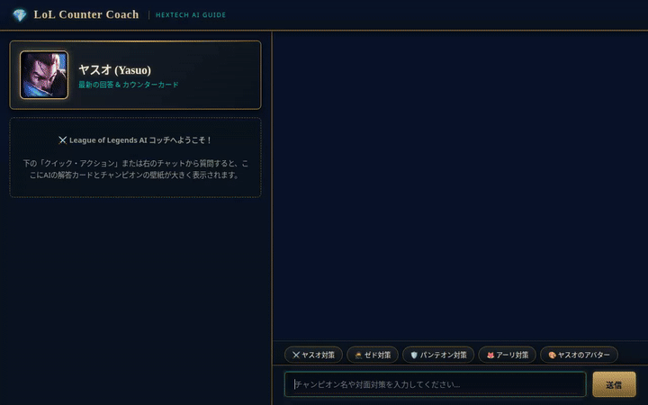

# LoL Counter Coach (Hextech AI Guide)

An AI-powered League of Legends Matchup & Counter Coach built with Google Agent Development Kit (ADK), Gemini on Vertex AI, A2UI rich surface cards, and Google Cloud Agent Runtime.



---

## 🌟 Overview

**LoL Counter Coach** helps League of Legends players counter opponent champions, optimize lane matchups, and execute high-level pro/ex-pro strategies. It intelligently resolves Japanese Katakana champion names (with typo and Hiragana fuzzy matching), displays live Riot Games patch stats, generates custom champion avatars, and remembers player champion pools across sessions.

---

## 🛠️ Implemented Features & Google Cloud Integrations

Based on the codebase in `app/` and `agents-cli-manifest.yaml`, the project incorporates the following wired-up tools and services:

* **Google Agent Development Kit (ADK) & Gemini**: Core agent logic implemented in Python using ADK (`google.adk`) with `gemini-flash-latest` on Vertex AI.
* **A2UI (Agent-to-User Interface)**: Native rich card UI rendering using `A2uiSchemaManager` (v0.8) and `BasicCatalog`. Outputs structured display cards for recommended counters, hard counter warnings ("絶対出してはいけない相手"), and pro strategy tips.
* **Vertex AI Memory Bank**: Cross-session long-term memory integration using `PreloadMemoryTool` and `add_session_to_memory` callback. Automatically remembers player main champions and role preferences.
* **Cloud Firestore**: Matchup data persistence in the `matchups` Firestore collection via `get_matchup_info` and `add_or_update_matchup` tools.
* **Vertex AI Image Generation (`gemini-3.1-flash-lite-image`) & Cloud Storage**: Generates custom anime-style champion avatar images (`generate_champion_avatar`) and hosts them on a public Google Cloud Storage bucket.
* **Agent Engine Sandbox Code Executor**: Runs isolated Python calculations (`AgentEngineSandboxCodeExecutor`) for stat scaling, gold efficiency, and damage calculations.
* **Riot Games Data Dragon API**: Live patch version and base stats lookup (`get_champion_live_stats`) fetching real-time HP, Armor, MR, Attack Range, and Move Speed.
* **Katakana & Typo Fuzzy Matching**: Comprehensive Japanese Katakana/Hiragana champion name normalization (`resolve_champion_name`) supporting spelling variations (`ヤスオ`, `ゼド`, `カタリナ`, `ルシアン`, `カイサ`, `ヴェルコズ`).

---

## 🚀 Setup & Local Execution

### Prerequisites
- Python 3.12+
- `uv` package manager
- `gcloud` CLI authenticated with Google Cloud

### 1. Install Dependencies
```bash
# In the project root (lol-counter-coach)
uv sync
```

### 2. Set Environment Variables
```bash
export AGENT_ENGINE_RESOURCE_NAME="projects/<PROJECT_NUMBER>/locations/us-central1/reasoningEngines/<REASONING_ENGINE_ID>"
export AGENT_DIRECTORY="app"
export PORT=8080
```

### 3. Run Local Frontend Proxy
```bash
cd frontend
uv run python main.py
```
Open a browser and navigate to port `8080` on your local host to access the Hextech Chat UI.

---

## ☁️ Deployment Instructions

### Deploy Agent Runtime Reasoning Engine
```bash
agents-cli deploy \
  --project <GCP_PROJECT_ID> \
  --region us-central1 \
  --update-env-vars GOOGLE_GENAI_USE_VERTEXAI=true \
  --no-confirm-project
```

### Deploy Frontend to Cloud Run
```bash
cd frontend
gcloud run deploy frontend \
  --source . \
  --region us-central1 \
  --allow-unauthenticated \
  --set-env-vars AGENT_ENGINE_RESOURCE_NAME="<AGENT_ENGINE_RESOURCE_NAME>",AGENT_DIRECTORY="app" \
  --project <GCP_PROJECT_ID>
```
